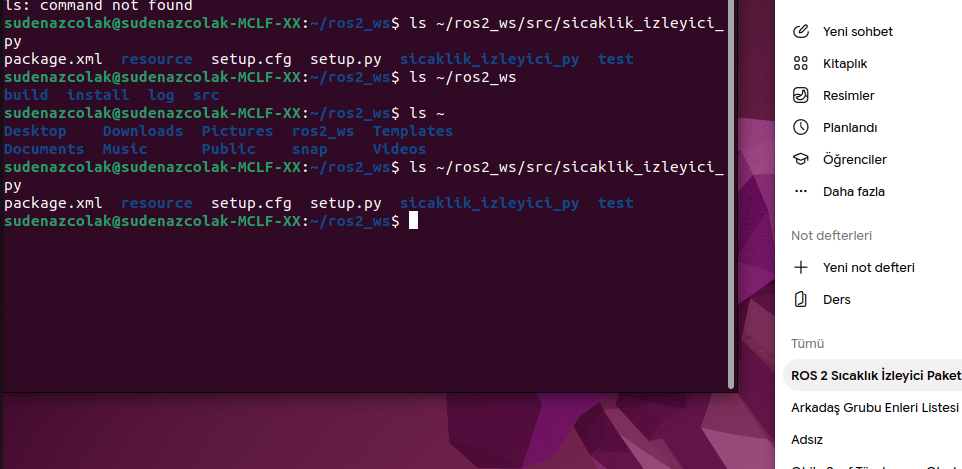

# Sıcaklık İzleyici ROS 2 Paketi

Bu paket, her saniye rastgele 20-40 °C arası sıcaklık üreten bir sensör düğümü ve 30 °C üzerindeki sıcaklıklarda uyarı veren izleyici düğümünü içerir.


## 📁 Proje Yapısı ve Çalışma Mantığı

Bu paket, ROS 2 üzerinde bir yayıncı-abone (Publisher-Subscriber) haberleşme mimarisi kullanır:

- **`sensor_node` (Yayıncı):** Her saniye rastgele 20–40 °C aralığında sıcaklık değerleri üreterek `/sicaklik` topiği üzerinden `std_msgs/msg/Float32` formatında yayınlar.
- **`izleyici_node` (Abone):** `/sicaklik` topiğini sürekli dinler. Okunan sıcaklık değerlerini terminale yazdırır; sıcaklık **30 °C'nin üzerine çıktığında** sisteme uyarı mesajı basar.
- **`/sicaklik Konusu:** Sensör ile izleyici düğümleri arasında veri iletimini sağlayan tek yönlü haberleşme kanalıdır.

## Derleme Adımları
```bash
cd ~/ros2_ws
colcon build --packages-select sicaklik_izleyici_py
source install/setup.bash
```
## ⚠️ Sıcaklık Eşik Aşımı (30°C Üstü) İzleyici Terminal Çıktısı


## RQT Graph

